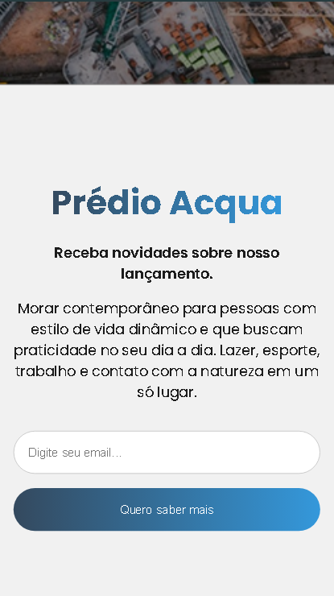
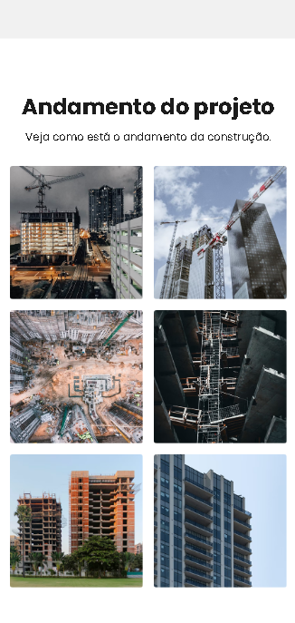

#  Acqua Project

A responsive institutional landing page from DevMentor to showcase a new building, developed as part of the [Transforme-se (Serasa + Instituto PROA)](https://www.serasaexperian.com.br/transforme-se/).

---

## <svg xmlns="http://www.w3.org/2000/svg" height="30px" viewBox="0 -960 960 960" width="40px" fill="#9ADBE8"><path d="M226.67-80q-27 0-46.84-19.83Q160-119.67 160-146.67v-666.66q0-27 19.83-46.84Q199.67-880 226.67-880h360.66L800-667.33v520.66q0 27-19.83 46.84Q760.33-80 733.33-80H226.67Zm0-66.67h506.66V-636H556v-177.33H226.67v666.66Zm253.51-66.66q61.49 0 103.99-43.09 42.5-43.08 42.5-103.58v-146.67h-53.34V-360q0 39-26.83 66.17-26.83 27.16-66.5 27.16-39 0-66.17-27.16Q386.67-321 386.67-360v-220q0-15 9.66-24.17 9.67-9.16 23.67-9.16 15 0 24.17 9.16 9.16 9.17 9.16 24.17v206.67h53.34V-580q0-36.4-25.06-61.53-25.05-25.14-61.33-25.14t-61.61 25.14Q333.33-616.4 333.33-580v220q0 60.5 43.14 103.58 43.13 43.09 103.71 43.09Zm-253.51-600V-636v-177.33 666.66-666.66Z"/></svg> Visual Preview


*Figure 1: Full desktop layout of the Acqua Project landing page.*

<p align="center">
  
  
</p>
<p align="center">
  <em>Figure 2: Mobile form (left) and progress page (right).</em>
</p>

---

## <svg xmlns="http://www.w3.org/2000/svg" height="30px" viewBox="0 -960 960 960" width="40px" fill="#9ADBE8"><path d="M480-80q-83 0-156-31.5T197-197q-54-54-85.5-127T80-480q0-83 31.5-156T197-763q54-54 127-85.5T480-880q64 0 121.83 18.5 57.84 18.5 106.5 52.83l-48.33 48q-39.33-25.33-84.67-39Q530-813.33 480-813.33q-139.33 0-236.33 97t-97 236.33q0 139.33 97 236.33t236.33 97q139.33 0 236.33-97t97-236.33q0-33.67-6.33-65.33Q800.67-577 788.33-606l50.34-50.67q20 40.34 30.66 84.5Q880-528 880-480q0 83-31.5 156T763-197q-54 54-127 85.5T480-80Zm0-162.67q-98.67 0-168-69.33t-69.33-168q0-98.67 69.33-168t168-69.33q29.67 0 57.33 7.16Q565-703 589.33-690l-50.66 50.67q-13.67-6-28.17-8.67-14.5-2.67-30.5-2.67-70.67 0-120.67 50t-50 120.67q0 70.67 50 120.67t120.67 50q35.33 0 66.5-13.5T601.33-360q21-21 32.84-48.17 11.83-27.16 12.5-56.5l64.66-65q13 59-3.66 116.84Q691-355 648-312q-32 32-75.33 50.67-43.34 18.66-92.67 18.66Zm0-150L368-504l47.33-46.67L480-486l350-350 46.67 46.67L480-392.67Z"/></svg> Overview & Objectives

Provide the contextual background for the project:
* **Problem / Motivation:** Raise awareness about sustainable water usage through a clear, accessible, and structured web interface built from scratch.
* **Scope:** A semantic, multi-section static web page developed as a practical team project for the DevMentors track within the Transforme-se initiative (Serasa Experian in partnership with Instituto PROA).
* **Core Takeaways:** Mastered pure HTML5 semantic architecture, CSS3 styling techniques (Flexbox and Grid), responsive design patterns across screen sizes, and Git team collaboration workflows prior to introducing JavaScript.

---

## <svg xmlns="http://www.w3.org/2000/svg" height="20px" viewBox="0 -960 960 960" width="40px" fill="#9ADBE8"><path d="M280-240q-100 0-170-70T40-480q0-100 70-170t170-70q74 0 128 36t82 95.33h430v217.34h-97.33V-240h-204v-131.33H490Q462-312 408-276t-128 36Zm0-66.67q69.33 0 113-44.83t51.67-86.5H688v131.33h68V-438h97.33v-84H444.67q-8-41.67-51.67-86.5t-113-44.83q-72 0-122.67 50.66Q106.67-552 106.67-480t50.66 122.67Q208-306.67 280-306.67ZM280-408q30.33 0 51.17-20.83Q352-449.67 352-480q0-30.33-20.83-51.17Q310.33-552 280-552q-30.33 0-51.17 20.83Q208-510.33 208-480q0 30.33 20.83 51.17Q249.67-408 280-408Zm0-72Z"/></svg> Key Deliverables / Features
* **Semantic Web Structure:** Built entirely with native HTML5 semantic tags (`header`, `nav`, `main`, `section`, `article`, `footer`) to ensure accessibility and clear document hierarchy.
* **Responsive Layout:** Fluid layouts implemented using CSS Flexbox and media queries to adapt cleanly between mobile devices, tablets, and desktop displays.
* **Styling & Visual Identity:** Cohesive color palette and typography centered around aquatic and environmental themes, utilizing CSS custom properties (variables) for consistent maintenance.
* **Extra:** Add a favicon and hover effect on the button, fixed img spacing using `display: block`, footer and border-radius to the images `ul`.
---

## <svg xmlns="http://www.w3.org/2000/svg" height="30px" viewBox="0 -960 960 960" width="40px" fill="#9ADBE8"><path d="M698.67-129.33 446-384q-22 8-44.17 12.67-22.16 4.66-45.83 4.66-98.06 0-166.69-68.44-68.64-68.45-68.64-166.22 0-32.67 8.77-63.1Q138.21-694.85 154-722l145.33 145.33L384.67-658l-148-148q26.94-16.11 57.14-25.05Q324-840 356-840q99.44 0 169.06 69.61 69.61 69.61 69.61 169.06 0 23.66-4.67 45.83-4.67 22.17-12.67 44.17l254 252.66q11.34 11.31 11.34 27.32 0 16.02-11.34 27.35l-78.66 74.67Q741.54-118 725.77-118q-15.77 0-27.1-11.33ZM727-195.67l35.67-35.66-267.34-267.34Q512-519.33 520-547.17q8-27.83 8-54.16 0-70-49.83-119.5Q428.33-770.33 362-774l92.67 94q10 10 9.66 23.67-.33 13.66-10.33 23.66l-131.33 126q-10.19 9.34-23.76 9.34-13.58 0-22.91-9.34L186-596q5 70.33 54.28 116.5T356-433.33q25.33 0 52.67-8 27.33-8 48.33-24.34l270 270ZM474.67-485.33Z"/></svg> Tools & Technologies

| Category | Tools / Frameworks |
| :--- | :--- |
| **Markup & Semantics** | HTML5 |
| **Styling & Layout** | CSS3 (Flexbox, CSS Variables, Media Queries) |
| **Design & Assets** | [Figma](https://www.figma.com/design/dXjS5pa4pHwrTpu8wQtNOC/Projeto-Acqua?node-id=0-1&p=f&t=VNKEvxgJjT33dCfy-0), [Google Fonts](https://fonts.google.com/specimen/Poppins) |
| **Version Control & Collaboration** | [Git, GitHub](https://github.com/dev-corvus)|
| **Code Editor** | Visual Studio Code |

---

## <svg xmlns="http://www.w3.org/2000/svg" height="30px" viewBox="0 -960 960 960" width="40px" fill="#9ADBE8"><path d="M146.67-160q-27 0-46.84-20.17Q80-200.33 80-226.67v-506.66q0-26.34 19.83-46.5Q119.67-800 146.67-800H414l66.67 66.67h332.66q26.34 0 46.5 20.16Q880-693 880-666.67v440q0 26.34-20.17 46.5Q839.67-160 813.33-160H146.67Zm0-66.67h666.66v-440H453l-66.67-66.66H146.67v506.66Zm0 0v-506.66V-226.67Z"/></svg> Project Structure

```text
├── images/         # buldings & icon
├── css/
│   ├── style.css       # stylesheets and responsive rules
├── index.htm